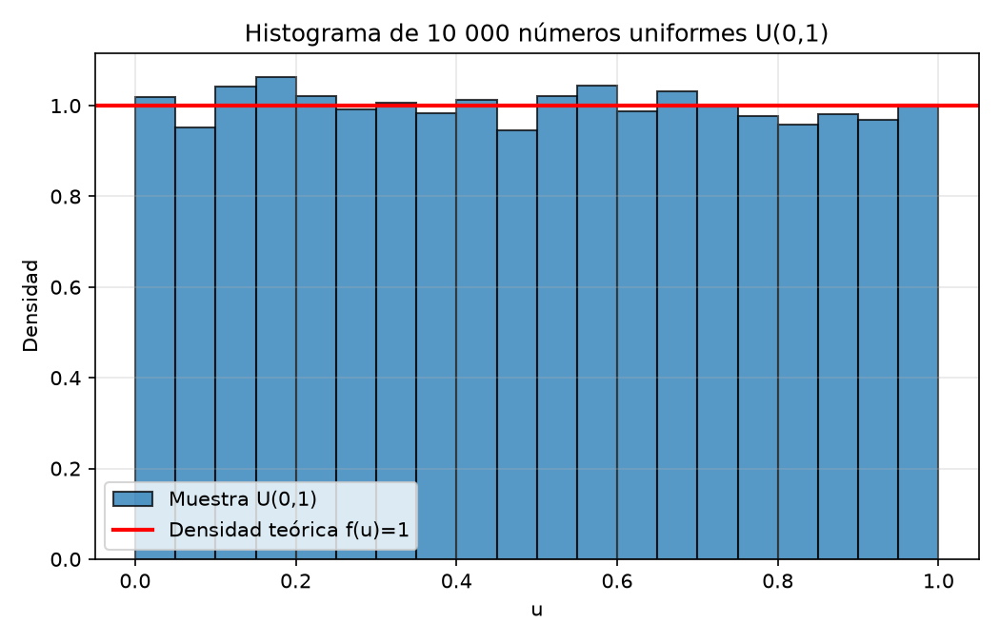
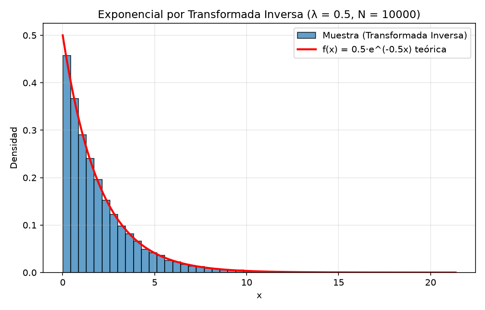
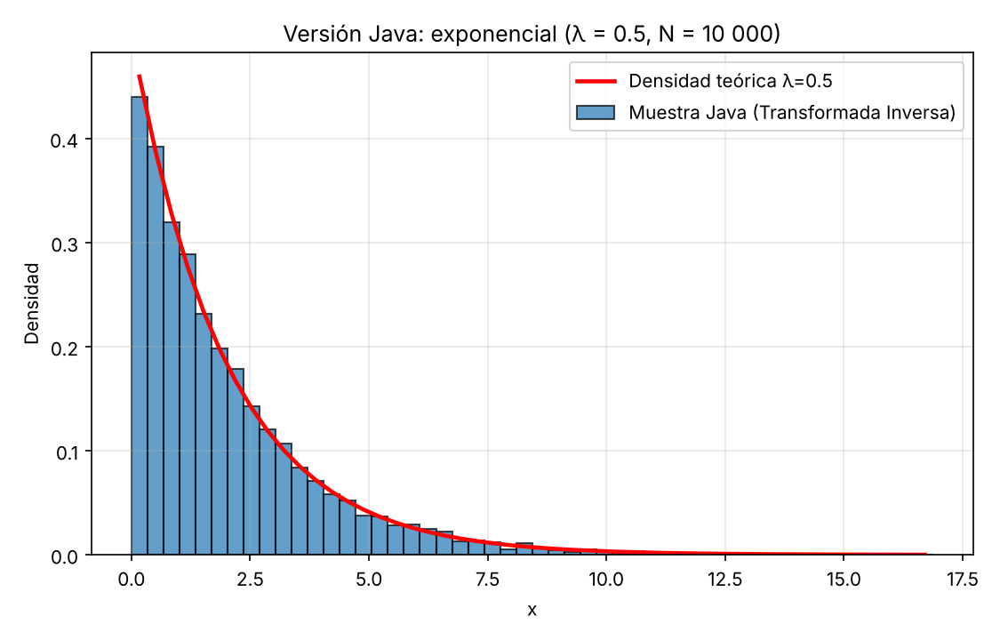
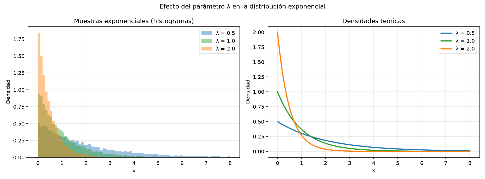

# Práctica 08 – Generación de variables aleatorias mediante el método de la Transformada Inversa

| | |
|---|---|
| **Asignatura** | Simulación – Ciclo 5 |
| **Carrera** | Computación – FEIRNNR, Universidad Nacional de Loja |
| **Unidad** | U2: Generación de números pseudoaleatorios y generación de variables aleatorias |
| **Docente** | José O. Guamán Q. |
| **Práctica** | Nro. 08 (no calificada, necesaria para la siguiente práctica) |

---

## 1. Objetivo

Implementar el método de la Transformada Inversa para generar variables aleatorias con distribuciones específicas:

1. Generar variables uniformes y exponenciales.
2. Implementar la Transformada Inversa.
3. Comparar las muestras obtenidas con las distribuciones teóricas.

## 2. Contenido del paquete

```
practica08/
├── README.md                  <- este documento (desarrollo, resultados y preguntas de control)
├── python/
│   └── practica08.py          <- implementación completa en Python (NumPy, Pandas, Matplotlib)
├── java/
│   └── Practica08.java        <- implementación equivalente en Java (sin librerías externas)
└── resultados/
    ├── 01_histograma_uniforme.png
    ├── 02_histograma_exponencial_vs_teorica.png
    ├── 03_comparacion_lambdas.png
    ├── 04_java_histograma_exponencial.png
    ├── tabla_comparativa.csv           (Python)
    ├── java_tabla_comparativa.csv      (Java)
    ├── java_histograma_lambda_0.5.csv  (Java, datos para graficar)
    ├── muestras_lambda_0.5.csv         (U y X generados en Python)
    ├── resumen_uniformes.csv
    ├── salida_python.txt               (salida de consola)
    └── salida_java.txt                 (salida de consola)
```

## 3. Cómo ejecutar

**Python** (requiere `numpy`, `pandas`, `matplotlib`):

```bash
cd python
pip install numpy pandas matplotlib
python practica08.py
```

**Java** (JDK 11 o superior):

```bash
cd java
javac Practica08.java
java Practica08
# alternativa con JDK 11+: java Practica08.java
```

Ambos programas usan una semilla fija (`42`) para que los resultados sean reproducibles. Se ejecutan desde su propia carpeta porque escriben en `../resultados/`.

---

## 4. Fundamento teórico

Si `U ~ U(0,1)` y `F` es la función de distribución acumulada (FDA) continua y estrictamente creciente de la variable deseada, entonces

```
X = F⁻¹(U)
```

tiene distribución `F`. Esto se debe a que `P(X ≤ x) = P(F⁻¹(U) ≤ x) = P(U ≤ F(x)) = F(x)`.

**Distribución exponencial:**

- Densidad: `f(x) = λ·e^(−λx)`, `x ≥ 0`
- FDA: `F(x) = 1 − e^(−λx)`
- Inversa: se iguala `u = 1 − e^(−λx)` → `e^(−λx) = 1 − u` → `−λx = ln(1 − u)` →

```
X = −ln(1 − U) / λ
```

- Media teórica: `E[X] = 1/λ`; varianza teórica: `Var[X] = 1/λ²`.
- Para la uniforme U(0,1): media `0.5`, varianza `1/12 ≈ 0.08333`.

*(Nota: como `1 − U` también es U(0,1), se podría usar `−ln(U)/λ`; aquí se mantiene `−ln(1 − U)/λ` tal como indica la guía. Además, con `U ∈ [0,1)` el valor `1 − U` nunca es 0, por lo que el logaritmo siempre está definido.)*

---

## 5. Desarrollo (los 5 algoritmos de la guía)

| # | Algoritmo de la guía | Función en el código |
|---|---|---|
| 1 | `Generar_Uniformes` (N = 10 000, media, varianza, histograma) | `generar_uniformes()` / `generarUniformes()` |
| 2 | `Transformada_Inversa` (λ = 0.5, verifica λ > 0, 10 primeros valores, cantidad) | `transformada_inversa()` / `transformadaInversa()` |
| 3 | `Comparar_Distribuciones` (histograma + curva teórica + título, ejes, leyenda) | `comparar_distribuciones()` / `histogramaCSV()` |
| 4 | `Comparar_Estadisticas` (media/varianza experimental vs. teórica y error %) | `comparar_estadisticas()` / `main()` |
| 5 | `Comparar_Valores_Lambda` (λ = 0.5, 1.0, 2.0 y gráfica comparativa) | `comparar_valores_lambda()` / `main()` |

El error porcentual se calcula como `|valor experimental − valor teórico| / valor teórico × 100`. La varianza experimental es la muestral (divisor `n − 1`).

---

## 6. Resultados

### 6.1 Uniformes U(0,1) – N = 10 000

| Medida | Teórico | Python | Java |
|---|---|---|---|
| Media | 0.50000 | 0.49712 | 0.50348 |
| Varianza | 0.08333 | 0.08307 | 0.08232 |



Las 20 barras del histograma quedan alrededor de la densidad teórica `f(u) = 1`, es decir, la muestra se comporta como U(0,1).

### 6.2 Transformada Inversa (λ = 0.5) – 10 primeros valores (Python)

| i | U[i] | X[i] = −ln(1−U)/0.5 |
|---|---|---|
| 1 | 0.77396 | 2.97405 |
| 2 | 0.43888 | 1.15564 |
| 3 | 0.85860 | 3.91230 |
| 4 | 0.69737 | 2.39048 |
| 5 | 0.09418 | 0.19782 |
| 6 | 0.97562 | 7.42818 |
| 7 | 0.76114 | 2.86375 |
| 8 | 0.78606 | 3.08416 |
| 9 | 0.12811 | 0.27419 |
| 10 | 0.45039 | 1.19708 |

**Cantidad de datos generados: 10 000.** (La salida completa de Java está en `resultados/salida_java.txt`.)

### 6.3 Histograma frente a densidad teórica (λ = 0.5)





El histograma sigue de cerca la curva roja `f(x) = 0.5·e^(−0.5x)` en ambas implementaciones.

### 6.4 Tabla comparativa (tabla de la sección 6 de la guía, completada)

**Python** (semilla 42, N = 10 000):

| λ | Media teórica | Media experimental | Varianza teórica | Varianza experimental | Error % media | Error % varianza |
|---|---|---|---|---|---|---|
| 0.5 | 2.00 | **1.98772** | 4.00 | **4.06513** | 0.614 % | 1.628 % |
| 1.0 | 1.00 | **0.99386** | 1.00 | **1.01628** | 0.614 % | 1.628 % |
| 2.0 | 0.50 | **0.49693** | 0.25 | **0.25407** | 0.614 % | 1.628 % |

**Java** (semilla 42, N = 10 000):

| λ | Media teórica | Media experimental | Varianza teórica | Varianza experimental | Error % media | Error % varianza |
|---|---|---|---|---|---|---|
| 0.5 | 2.00 | **2.01136** | 4.00 | **3.96286** | 0.568 % | 0.929 % |
| 1.0 | 1.00 | **1.00568** | 1.00 | **0.99071** | 0.568 % | 0.929 % |
| 2.0 | 0.50 | **0.50284** | 0.25 | **0.24768** | 0.568 % | 0.929 % |

> **Observación:** los errores porcentuales son idénticos para los tres valores de λ porque se reutiliza la misma muestra `U` en todos los casos, y `X_λ = X_1 / λ`. Al cambiar λ solo se reescala la muestra, de modo que el error relativo no cambia. Las diferencias entre Python y Java se deben a que cada lenguaje usa un generador pseudoaleatorio distinto (PCG64 en NumPy, congruencial lineal de 48 bits en `java.util.Random`), por lo que las muestras no coinciden aunque la semilla sea la misma.

### 6.5 Efecto de λ



Al aumentar λ la densidad inicial `f(0) = λ` crece y la cola se acorta: los valores se concentran más cerca de cero.

---

## 7. Preguntas de control

**1. ¿Por qué es necesario generar primero números aleatorios uniformes para aplicar el método de la Transformada Inversa?**

Porque la FDA `F(x)` toma valores en el intervalo (0,1), y el método consiste en invertirla. Para que `X = F⁻¹(U)` tenga distribución `F`, `U` debe ser uniforme en (0,1): así cada intervalo de probabilidad de igual tamaño se transforma en un intervalo de valores de `X` con exactamente esa probabilidad. Además, la uniforme U(0,1) es la distribución que los computadores generan de forma directa (generadores congruenciales, Mersenne Twister, PCG, etc.), por lo que sirve como materia prima común para obtener cualquier otra distribución.

**2. ¿Qué relación existe entre la función de distribución acumulada y su función inversa?**

La FDA asigna a cada valor `x` la probabilidad acumulada `u = F(x) = P(X ≤ x)`. La función inversa hace el camino contrario: dada una probabilidad `u`, devuelve el valor `x = F⁻¹(u)` (el cuantil de orden `u`). Se cumple `F(F⁻¹(u)) = u` y `F⁻¹(F(x)) = x`. En el método, se sortea una probabilidad `u` al azar y se busca qué valor de `x` deja exactamente esa probabilidad acumulada a su izquierda. Para la exponencial: `F(x) = 1 − e^(−λx)` y `F⁻¹(u) = −ln(1 − u)/λ`.

**3. ¿Por qué la distribución exponencial presenta una mayor concentración de valores cerca de cero?**

Porque su densidad `f(x) = λe^(−λx)` es máxima en `x = 0` (vale λ) y decrece de forma exponencial. Desde la transformación: `X = −ln(1 − U)/λ`, y la mayoría de los valores de `U` no están cerca de 1. Por ejemplo, el 50 % de las muestras cumple `U < 0.5` y por tanto `X < ln(2)/λ ≈ 0.69/λ`, mientras que valores grandes de `X` solo aparecen cuando `U` está muy cerca de 1 (un evento poco probable). Es decir, `P(X ≤ x) = 1 − e^(−λx)` crece muy rápido al principio. Esta propiedad se refleja en la falta de memoria: los tiempos de espera cortos son mucho más frecuentes que los largos.

**4. ¿Qué sucede con la media y la varianza cuando aumenta el parámetro λ?**

Ambas disminuyen: `E[X] = 1/λ` y `Var[X] = 1/λ²`. Si λ es la tasa de ocurrencia, un λ mayor significa eventos más frecuentes, tiempos de espera más cortos y menos dispersión. La tabla lo confirma: al pasar de λ = 0.5 a 1.0 y 2.0, la media baja de 2.0 a 1.0 y 0.5, y la varianza de 4.0 a 1.0 y 0.25. Gráficamente, la curva se hace más alta en 0 y su cola se vuelve más corta. Como la media es `1/λ` y la desviación estándar también es `1/λ`, ambas se reducen en la misma proporción, y la varianza decrece más rápido (con el cuadrado).

**5. ¿Por qué existen diferencias entre las medidas estadísticas experimentales y las teóricas?**

Porque la muestra es finita (N = 10 000) y pseudoaleatoria: los estadísticos muestrales son variables aleatorias que fluctúan alrededor del valor teórico. El error típico de la media es `σ/√N`; para λ = 0.5 es `2/√10000 = 0.02`, y la diferencia observada (≈ 0.012 en Python y ≈ 0.011 en Java) cae dentro de ese rango. Contribuyen también la calidad del generador uniforme (no es verdaderamente aleatorio), la precisión de punto flotante y, en la varianza, que su estimador converge más lentamente porque la exponencial tiene cola larga. Estas diferencias disminuyen al aumentar N (ley de los grandes números) y cambian al modificar la semilla.

**6. ¿Qué ventajas ofrece el método de la Transformada Inversa frente a la generación directa de variables aleatorias?**

- Solo necesita un generador U(0,1), que ya existe en cualquier lenguaje; no se requiere un generador específico por cada distribución.
- Es exacto (no aproximado) cuando existe `F⁻¹` en forma cerrada, como en la exponencial, uniforme general, Weibull, Pareto o triangular.
- Es eficiente: usa un solo número uniforme por cada variable generada, sin rechazos (a diferencia del método de aceptación-rechazo).
- Es monótono, lo que permite reducir la varianza con técnicas como variables antitéticas y números aleatorios comunes (como se hizo aquí al reutilizar `U` para los tres λ).
- Sirve también para distribuciones discretas (buscando el primer valor cuya FDA supera a `U`) y para distribuciones empíricas.
- Su limitación es que requiere conocer y poder invertir `F` (por ejemplo, la normal no tiene inversa en forma cerrada y se necesita aproximarla numéricamente o usar otros métodos como Box-Muller).

**7. ¿En qué situaciones reales podría utilizarse una distribución exponencial para modelar tiempos de espera?**

Siempre que se modelen tiempos entre eventos independientes con tasa promedio constante (proceso de Poisson):

- Tiempo entre llegadas de clientes a una caja de banco, un cajero automático o una cola de atención.
- Tiempo entre llamadas a un centro de atención telefónica o entre peticiones a un servidor web.
- Tiempo de servicio en sistemas de colas M/M/1 y M/M/c.
- Tiempo entre fallas de un componente electrónico (vida útil con tasa de falla constante).
- Tiempo entre llegadas de buses o pacientes a emergencias.
- Decaimiento radiactivo: tiempo entre desintegraciones.
- Tiempo entre llegadas de paquetes en redes de computadores.

En estos casos la propiedad de pérdida de memoria (la probabilidad de esperar un tiempo adicional no depende del tiempo ya esperado) debe ser razonable.

---

## 8. Conclusiones

- El generador uniforme produjo 10 000 números con media ≈ 0.50 y varianza ≈ 0.083, consistentes con U(0,1) (valores teóricos 0.5 y 0.0833).
- La transformación `X = −ln(1 − U)/λ` generó muestras exponenciales cuyo histograma se ajusta a la densidad teórica `λe^(−λx)` para los tres valores de λ probados.
- Las medias y varianzas experimentales difieren de las teóricas menos del 2 % (error máximo: 1.63 % en Python y 0.93 % en Java), dentro de lo esperado para N = 10 000.
- Aumentar λ reduce la media (1/λ) y la varianza (1/λ²) y concentra los datos más cerca de cero.
- Los resultados de Python y Java son estadísticamente equivalentes; las diferencias numéricas provienen de los distintos generadores pseudoaleatorios.

## 9. Bibliografía

- Diapositivas de la semana 8, asignatura Simulación, UNL.
- Documentación de NumPy, Pandas y Matplotlib.
